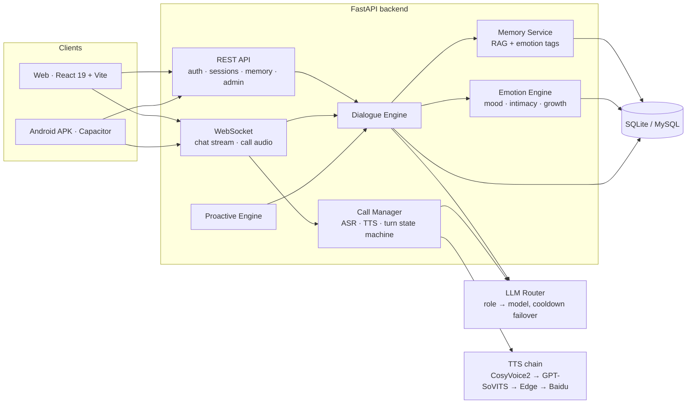

<p align="center">
  <a href="README.md"><b>English</b></a> ·
  <a href="README.zh-CN.md">简体中文</a>
</p>

# Miaoyi（喵艺）· An AI Companion That Feels, Remembers, and Talks

> A full-stack AI companion app with an emotion engine, long-term memory, real-time voice calls, and proactive care.
> Built with **FastAPI + React 19 + WebSocket**, and shipped as both a **web app** and an **Android APK** through Capacitor.

[](https://github.com/Yizhimao626/miaoyi/actions/workflows/ci.yml)
[](LICENSE)
[](https://www.python.org/)
[](https://fastapi.tiangolo.com/)
[](https://react.dev/)
[](CONTRIBUTING.md)

<p align="center">
  
</p>
<p align="center"><em>Live demo — send a message, watch the streaming reply (16 s, recorded from the running app)</em></p>

<p align="center">
  
  
  
  
</p>
<p align="center"><em>Home · Chat · Memory · Login — captured from the running app</em></p>
<p align="center"><sub>Images not loading? Some networks block <code>camo.githubusercontent.com</code>, which GitHub uses to proxy every README image.
The screenshots are also in <a href="docs/screenshots">docs/screenshots</a>.</sub></p>

---

## Why this project is worth a look

Most "AI chatbot" demos stop at *send a message → get a reply*. Miaoyi is built as a small product, and the interesting part is everything around the reply:

1. **Dual-brain LLM routing** — a cheap, fast model handles intent classification and emotion analysis as JSON; a stronger reasoning model writes the actual reply. Providers sit in a pool with role-based routing and automatic failover (60 s cooldown per provider).
2. **An emotion engine that changes behavior** — four persistent state dimensions (`joy`, `arousal`, `intimacy`, `trust`) with natural decay are injected into every prompt, so the same input does not always produce the same answer.
3. **End-to-end voice calls** — binary audio over WebSocket, faster-whisper for ASR, and a TTS fallback chain (CosyVoice2 → GPT-SoVITS → Edge TTS → Baidu → gTTS) that degrades gracefully instead of failing.
4. **Memory with retrieval** — embeddings + emotion tags, retrieved per turn and surfaced as memory cards in the UI.
5. **Proactive care** — a scheduler decides when to reach out, so the app is not purely reactive.
6. **One codebase, three targets** — React web, Capacitor Android APK (with in-app update), and an optional Electron desktop shell.

---

## Architecture



More detail: [docs/ARCHITECTURE.md](docs/ARCHITECTURE.md) · [中文版](docs/ARCHITECTURE.zh-CN.md)

---

## What's actually implemented

No benchmark theatre — this is the code-level status of the repository:

| Area | Status | What it does |
|---|---|---|
| Emotion engine | ✅ working | Joy / arousal / intimacy / trust persisted per user, hourly decay, injected into prompts |
| Memory | ✅ working | Embedding retrieval + emotion tags; results rendered as memory cards |
| Dialogue | ✅ working | WebSocket streaming, dual-model role routing, provider failover with cooldown |
| Voice call | ✅ working (needs ASR/TTS) | Binary audio over WebSocket, faster-whisper ASR, multi-tier TTS fallback |
| Proactive care | ✅ working | Scheduler-driven outreach based on inactivity and relationship state |
| Clients | ✅ working | React web, Capacitor Android APK with in-app update, optional Electron shell |
| Offline demo | ✅ working | Built-in mock LLM: register → login → chat works with **zero API keys** |
| Admin console | ✅ optional | Separate Vite app for user and content management |
| Public demo site | ⏳ planned | Rate-limited guest instance is on the roadmap |

This was built and operated as a personal project for a small number of real users; it is honest about being a hobby-scale deployment, not a hyperscale service.

---

## Tech stack

| Layer | Choice |
|---|---|
| Backend | Python 3.10+, FastAPI, WebSocket, SQLite (default) / MySQL (optional) |
| LLM | Zhipu GLM-4-Flash / GLM-4V-Flash, DeepSeek, DashScope Qwen, Moonshot — pluggable pool |
| Offline demo | Built-in mock provider — the full flow runs without any API key |
| Memory | Embedding-based RAG + emotion-tagged memory records |
| Speech | faster-whisper (ASR), CosyVoice2 / GPT-SoVITS / Edge TTS / Baidu TTS / gTTS (TTS) |
| Frontend | React 19, TypeScript, Vite 6, Zustand |
| Mobile | Capacitor 8, Android Gradle (compileSdk 36, minSdk 24, JDK 21) |
| Deploy | systemd / Docker Compose, single VM friendly |

---

## Quick start

```bash
git clone https://github.com/Yizhimao626/miaoyi.git
cd miaoyi

python -m venv .venv
source .venv/bin/activate          # Windows: .venv\Scripts\activate
pip install -r requirements.txt

cp config.example.yaml config.yaml
cp .env.example .env               # optional: add a key for real models

# required once: put a random value into JWT_SECRET_KEY in .env
python -c "import secrets; print(secrets.token_hex(32))"

python server.py                   # backend → http://localhost:8001
```

Frontend in dev mode:

```bash
cd frontend
npm install
npm run dev                        # Vite dev server, proxied to :8001
```

Docker:

```bash
cp .env.example .env               # set JWT_SECRET_KEY; keys optional (demo mode)
docker compose up -d
```

> **No API key?** The backend automatically falls back to *offline demo mode*: replies are generated by a built-in mock provider, so register → login → chat → memory still works end to end without calling any external model. Force it with `MIAOYI_MOCK_LLM=1`, disable it with `MIAOYI_MOCK_LLM=0`.
>
> `JWT_SECRET_KEY` is mandatory: the backend refuses to start without it (security check). `ZHIPU_API_KEY` / `DEEPSEEK_API_KEY` are optional thanks to demo mode.
>
> Speech features additionally need a reachable ASR/TTS backend; otherwise the app falls back to text-only.

---

## Configuration

Two files drive everything: `.env` for secrets and deployment switches, `config.yaml` for behaviour.

- **Required:** `JWT_SECRET_KEY` — the backend refuses to start without it.
- **Optional:** every LLM key. With none configured, the app runs in offline demo mode.
- **Provider pool:** an ordered list; a failing provider enters a 60 s cooldown and the next one takes over. Providers without a key are skipped at startup.
- **Role routing:** eight internal roles (`chat`, `light`, `inner`, `think`, `emotion`, `tool`, `memory`, `proactive`), each pointing at a model — cheap models for analysis, a stronger one for the reply the user actually reads.
- **Voice:** CosyVoice2 → GPT-SoVITS → Edge TTS → Baidu → local → gTTS, degrading automatically.

Environment variables, every `config.yaml` section, and cost-control recipes:
[docs/CONFIGURATION.md](docs/CONFIGURATION.md) · [中文](docs/CONFIGURATION.zh-CN.md)

---

## API

All routes live in `server.py`, and there are two ways to talk to the backend:

- **REST** — envelope `{ "code", "data", "message" }`, auth via `Authorization: Bearer <access_token>`
- **WebSocket** — `/ws?token=<access_token>`; streaming `response_chunk` frames for chat, binary frames for call audio

| Example | Endpoint |
|---|---|
| Login | `POST /api/auth/login` |
| Chat (non-streaming) | `POST /api/message` |
| Chat (SSE) | `POST /api/message/stream` |
| Emotion state | `GET /api/emotion/state` |
| Memories | `GET /api/memory/list` |
| App update check | `GET /api/version/check` |

Full endpoint catalogue, request examples and WebSocket close codes:
[docs/API.md](docs/API.md) · [中文](docs/API.zh-CN.md)

---

## Repository layout

```
├── server.py            # FastAPI entry point and HTTP/WS routes
├── db_manager.py        # SQLite/MySQL data access layer
├── app_state.py         # global application state
├── core/                # engines: dialogue, emotion, memory, persona, LLM router, speech…
├── services/            # message service
├── utils/               # logger, config manager, session helpers
├── frontend/            # React 19 app + Capacitor Android project
├── admin/               # optional admin console (Vite)
├── site/                # static pages (privacy policy / terms)
├── docs/                # architecture, configuration, API notes and screenshots
├── scripts/ tests/      # tooling and tests
├── config.example.yaml  # configuration template
└── .env.example         # environment template
```

---

## Contributing — you're invited

This project is meant to grow with contributors, not just to sit in a portfolio. If you like the idea of an AI companion that remembers and *changes*, there is room for you here.

- **Good first issues** — [pick one and say "I'll take it"](https://github.com/Yizhimao626/miaoyi/issues?q=is%3Aissue+is%3Aopen+label%3A%22good+first+issue%22)
- **Ideas and questions** — [start a discussion](https://github.com/Yizhimao626/miaoyi/discussions)
- **Before a PR** — read [CONTRIBUTING.md](CONTRIBUTING.md); small, focused changes are easiest to review

Areas where help is most useful:

| Area | What we need |
|---|---|
| Docs | English/Chinese translations, diagrams, setup walkthroughs |
| Testing | Unit tests for the emotion engine, dialogue engine, and LLM pool |
| Frontend | Accessibility, mobile layout polish, animation |
| Speech | More TTS/ASR backends, especially local-first ones |
| Refactor | Splitting `server.py` into routers (see roadmap) |

If you build something with this code, tell us in Discussions — we would love to link it from here.

---

## Roadmap

- [ ] Split `server.py` into `app/api/routes/*` (chat / call / auth / memory / admin)
- [ ] Raise test coverage for the emotion and dialogue engines
- [ ] Publish a public demo instance with a rate-limited guest account
- [x] One-command local stack (compose profile with mock LLM, no API key required)
- [ ] English documentation for the persona / style-mimicry subsystem

---

## About this repository

This is a **sanitized showcase version** of a personal project (current app version: `1.1.9`):

- No API keys, production configuration, or server addresses
- No user data, chat history, or private persona corpora
- No model weights or media assets beyond what is needed to read the code

It is intended for learning and portfolio review. If you plan to run a public instance, review the local regulations that apply to generative AI services in your region.

> **Not included:** persona prompts (`prompts/`), media assets (`assets/`), model weights, and user data. The code runs without them, but the full conversational experience needs your own persona files and at least one LLM API key.

## License

[AGPL-3.0](LICENSE) — you may use, modify and self-host it, but if you run a modified version as a network service, you must publish your changes.

## Security

Please report vulnerabilities privately — see [SECURITY.md](SECURITY.md). Do not open a public issue for anything involving credentials or user data.
