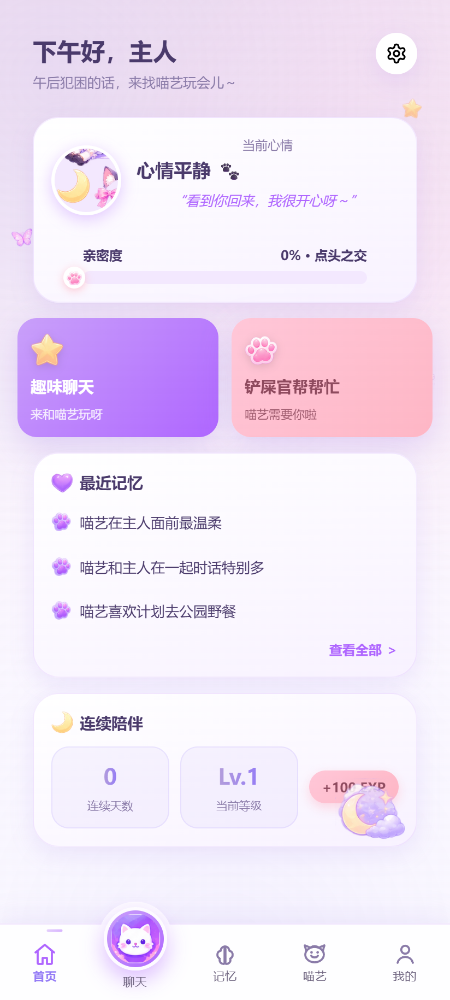
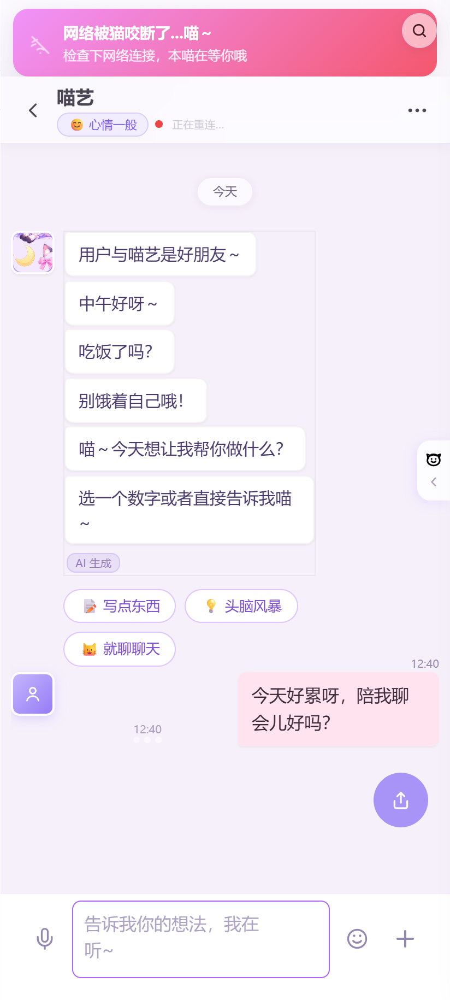
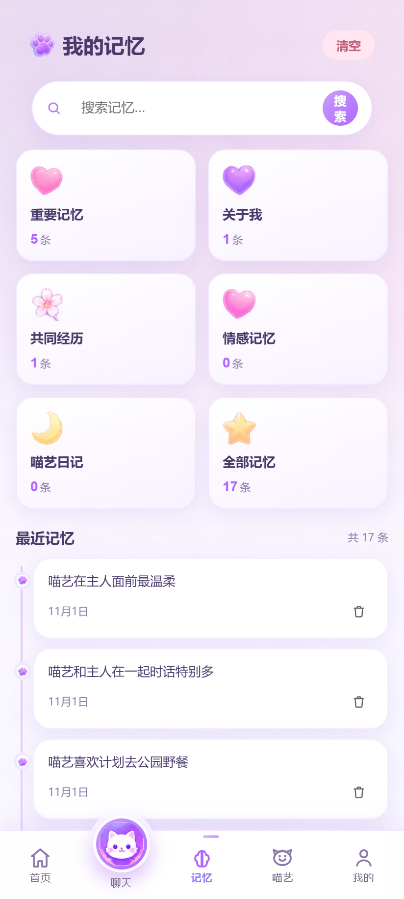
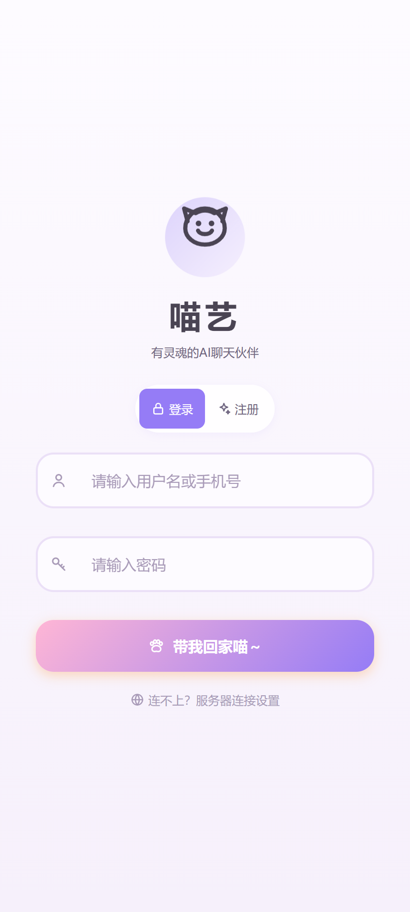
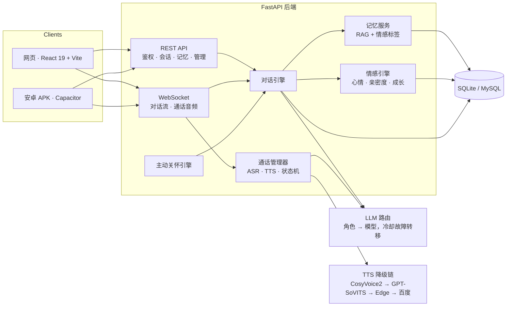

# 喵艺 · 会感知情绪、记得住你、还能打电话的 AI 陪伴应用

> 全栈 AI 陪伴应用：情感引擎 + 长期记忆 + 实时语音通话 + 主动关怀。
> 技术栈 **FastAPI + React 19 + WebSocket**，同一套代码同时产出 **网页版** 与 **安卓 APK**（Capacitor）。

[](LICENSE)
[](https://www.python.org/)
[](https://fastapi.tiangolo.com/)
[](https://react.dev/)
[](CONTRIBUTING.md)

<p align="center">
  
</p>
<p align="center"><em>实时演示：发送消息 → 流式回复（16 秒，取自线上运行实例）</em></p>

<p align="center">
  
  
  
  
</p>
<p align="center"><em>首页 · 聊天 · 记忆 · 登录 —— 实机截图</em></p>

---

## 为什么这个项目值得一看

大多数「AI 聊天 Demo」止步于 **发消息 → 收回复**。喵艺是按一个真实产品做的，真正有意思的是回复之外的部分：

1. **双脑 LLM 路由** —— 便宜快的模型负责意图分类与情绪分析（输出 JSON），更强的推理模型负责真正说出口的那句话；多供应商池按角色路由，单供应商故障后 60 秒冷却自动切换。
2. **会改变行为的情感引擎** —— 心情、亲密度、成长等级按用户持久化，并注入每一轮 prompt，同样一句话不会永远得到同样的回复。
3. **完整语音通话链路** —— WebSocket 传输二进制音频，faster-whisper 识别，TTS 降级链（CosyVoice2 → GPT-SoVITS → Edge TTS → 百度 → gTTS）逐级兜底而不是直接失败。
4. **可检索的记忆** —— 向量化 + 情感标签，按轮次检索，并在界面中以记忆卡片呈现。
5. **主动关怀** —— 调度器决定何时主动开口，而不是纯被动应答。
6. **一套代码，三个端** —— React 网页、Capacitor 安卓 APK（含应用内更新）、可选 Electron 桌面壳。

---

## 架构图



---

## 实测数据

2 vCPU / 2 GB 云服务器、单用户、连接已预热：

| 指标 | 快路径（轻任务） | 主回复路径 |
|---|---|---|
| 首 token | 0.7 – 1.0 s | 1.5 – 1.9 s |
| 回复长度 | 8 – 13 tokens | 119 – 150 tokens |
| 供应商故障转移 | 自动，60 秒冷却 | 自动，60 秒冷却 |

快模型专门留给延迟敏感的子任务（意图、情绪 JSON、工具路由），推理模型只负责用户真正读到的那段正文。

---

## 技术栈

| 层 | 选型 |
|---|---|
| 后端 | Python 3.10+、FastAPI、WebSocket、SQLite（默认）/ MySQL（可选） |
| 大模型 | 智谱 GLM-4-Flash / GLM-4V-Flash、DeepSeek、百炼 Qwen、Moonshot —— 可插拔供应商池 |
| 离线演示 | 内置 mock 提供方 —— 没有任何 API Key 也能跑通全链路 |
| 记忆 | 向量检索 + 情感标签记忆 |
| 语音 | faster-whisper（识别）、CosyVoice2 / GPT-SoVITS / Edge TTS / 百度 TTS / gTTS（合成） |
| 前端 | React 19、TypeScript、Vite 6、Zustand |
| 移动端 | Capacitor 8、Android Gradle（compileSdk 36 / minSdk 24 / JDK 21） |
| 部署 | systemd / Docker Compose，单机友好 |

---

## 快速开始

```bash
git clone https://github.com/<your-name>/miaoyi.git
cd miaoyi

python -m venv .venv
source .venv/bin/activate          # Windows: .venv\Scripts\activate
pip install -r requirements.txt

cp config.example.yaml config.yaml
cp .env.example .env               # 可选：填 Key 才会走真实模型

# 必填一次：把下面生成的随机串填到 .env 的 JWT_SECRET_KEY
python -c "import secrets; print(secrets.token_hex(32))"

python server.py                   # 后端 → http://localhost:8001
```

前端开发模式：

```bash
cd frontend
npm install
npm run dev                        # Vite 开发服务器，代理到 :8001
```

Docker：

```bash
cp .env.example .env               # 先填 JWT_SECRET_KEY；不填 Key 也能跑（离线演示模式）
docker compose up -d
```

> **没配 API Key？** 后端会自动进入*离线演示模式*：回复由内置 mock 提供方生成，注册 → 登录 → 聊天 → 记忆全链路照常可走，不会调用任何外部模型。`MIAOYI_MOCK_LLM=1` 强制启用、`0` 强制关闭。
>
> `JWT_SECRET_KEY` 为必填：没有它后端会直接拒绝启动（安全校验）。`ZHIPU_API_KEY` / `DEEPSEEK_API_KEY` 则因为有离线演示模式而变成可选。
>
> 语音功能还需要可用的 ASR/TTS，否则自动降级为纯文本。

---

## 目录结构

```
├── server.py            # FastAPI 入口与 HTTP/WS 路由
├── db_manager.py        # SQLite/MySQL 数据访问层
├── app_state.py         # 应用全局状态
├── core/                # 引擎层：对话、情感、记忆、人格、LLM 路由、语音…
├── services/            # 消息服务
├── utils/               # 日志、配置、会话工具
├── frontend/            # React 19 应用 + Capacitor 安卓工程
├── admin/               # 可选管理后台（Vite）
├── site/                # 静态页（隐私政策 / 服务条款）
├── docs/                # 架构说明与截图
├── scripts/ tests/      # 脚本与测试
├── config.example.yaml  # 配置模板
└── .env.example         # 环境变量模板
```

---

## 路线图

- [ ] 拆分 `server.py` 为 `app/api/routes/*`（对话 / 通话 / 鉴权 / 记忆 / 管理）
- [ ] 补充情感引擎与对话引擎的单元测试
- [ ] 提供限流游客账号的公开演示站
- [x] 一条命令起本地栈（mock LLM，无需 API Key）
- [ ] 人格 / 风格学习子系统的英文文档

---

## 关于本仓库

这是个人项目的 **脱敏展示版**：

- 不含 API Key、生产配置与服务器地址
- 不含用户数据、聊天记录与私有语料
- 不含模型权重与多余媒体资源

仅供学习与作品集评估。若要在公网运行实例，请先确认所在地区对生成式 AI 服务的合规要求。

> **未包含：** 人格提示词（`prompts/`）、媒体资源（`assets/`）、模型权重与用户数据。没有这些也能跑代码，但完整体验需要自备人格文件并配置至少一个大模型 Key。

## 许可证

[AGPL-3.0](LICENSE) —— 允许使用、修改与自托管；若将修改版作为网络服务对外提供，需公开你的改动。

## 安全

安全问题请通过私下渠道反馈，见 [SECURITY.md](SECURITY.md)。涉及凭据或用户数据的问题请勿开公开 Issue。
