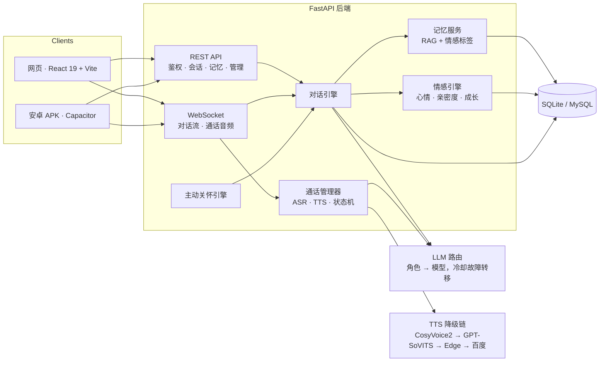

<p align="center">
  <a href="README.md">English</a> ·
  <a href="README.zh-CN.md"><b>简体中文</b></a>
</p>

# 喵艺 · 会感知情绪、记得住你、还能打电话的 AI 陪伴应用

> 全栈 AI 陪伴应用：情感引擎 + 长期记忆 + 实时语音通话 + 主动关怀。
> 技术栈 **FastAPI + React 19 + WebSocket**，同一套代码同时产出 **网页版** 与 **安卓 APK**（Capacitor）。

[](LICENSE)
[](https://www.python.org/)
[](https://fastapi.tiangolo.com/)
[](https://react.dev/)
[](CONTRIBUTING.md)

<p align="center">
  
</p>
<p align="center"><em>实时演示：发送消息 → 流式回复（16 秒，取自线上运行实例）</em></p>

<p align="center">
  
  
  
  
</p>
<p align="center"><em>首页 · 聊天 · 记忆 · 登录 —— 实机截图</em></p>
<p align="center"><sub>图片没显示？部分网络会屏蔽 <code>camo.githubusercontent.com</code>（GitHub 用来代理所有 README 图片的域名）。
截图原文件也在 <a href="docs/screenshots">docs/screenshots</a>。</sub></p>

---

## 为什么这个项目值得一看

大多数「AI 聊天 Demo」止步于 **发消息 → 收回复**。喵艺是按一个真实产品做的，真正有意思的是回复之外的部分：

1. **双脑 LLM 路由** —— 便宜快的模型负责意图分类与情绪分析（输出 JSON），更强的推理模型负责真正说出口的那句话；多供应商池按角色路由，单供应商故障后 60 秒冷却自动切换。
2. **会改变行为的情感引擎** —— `joy`（愉悦）、`arousal`（唤醒）、`intimacy`（亲密）、`trust`（信任）四个维度按用户持久化并自然衰减，注入每一轮 prompt，同样一句话不会永远得到同样的回复。
3. **完整语音通话链路** —— WebSocket 传输二进制音频，faster-whisper 识别，TTS 降级链（CosyVoice2 → GPT-SoVITS → Edge TTS → 百度 → gTTS）逐级兜底而不是直接失败。
4. **可检索的记忆** —— 向量化 + 情感标签，按轮次检索，并在界面中以记忆卡片呈现。
5. **主动关怀** —— 调度器决定何时主动开口，而不是纯被动应答。
6. **一套代码，三个端** —— React 网页、Capacitor 安卓 APK（含应用内更新）、可选 Electron 桌面壳。

---

## 架构图



更多细节：[docs/ARCHITECTURE.zh-CN.md](docs/ARCHITECTURE.zh-CN.md) · [English](docs/ARCHITECTURE.md)

---

## 实际实现了什么

不放虚的跑分数字，这里按代码的真实状态列出：

| 模块 | 状态 | 说明 |
|---|---|---|
| 情感引擎 | ✅ 可用 | joy / arousal / intimacy / trust 四维持久化，按小时衰减，注入 prompt |
| 记忆 | ✅ 可用 | 向量检索 + 情感标签，结果以记忆卡片呈现 |
| 对话 | ✅ 可用 | WebSocket 流式输出，双模型角色路由，供应商冷却故障转移 |
| 语音通话 | ✅ 可用（需 ASR/TTS） | WebSocket 二进制音频，faster-whisper 识别，多级 TTS 兜底 |
| 主动关怀 | ✅ 可用 | 依据沉默时长与关系状态由调度器触发 |
| 三端 | ✅ 可用 | React 网页、Capacitor 安卓 APK（应用内更新）、可选 Electron |
| 离线演示 | ✅ 可用 | 内置 mock LLM：**零 API Key** 也能注册 → 登录 → 聊天 |
| 管理后台 | ✅ 可选 | 独立 Vite 应用，用于用户与内容管理 |
| 公开演示站 | ⏳ 计划中 | 限流游客实例在路线图中 |

这是作为个人项目、面向少量真实用户开发和运营的；它诚实地定位在业余规模，而不是超大规模服务。

---

## 技术栈

| 层 | 选型 |
|---|---|
| 后端 | Python 3.10+、FastAPI、WebSocket、SQLite（默认）/ MySQL（可选） |
| 大模型 | 智谱 GLM-4-Flash / GLM-4V-Flash、DeepSeek、百炼 Qwen、Moonshot —— 可插拔供应商池 |
| 离线演示 | 内置 mock 提供方 —— 没有任何 API Key 也能跑通全链路 |
| 记忆 | 向量检索 + 情感标签记忆 |
| 语音 | faster-whisper（识别）、CosyVoice2 / GPT-SoVITS / Edge TTS / 百度 TTS / gTTS（合成） |
| 前端 | React 19、TypeScript、Vite 6、Zustand |
| 移动端 | Capacitor 8、Android Gradle（compileSdk 36 / minSdk 24 / JDK 21） |
| 部署 | systemd / Docker Compose，单机友好 |

---

## 快速开始

```bash
git clone https://github.com/Yizhimao626/miaoyi.git
cd miaoyi

python -m venv .venv
source .venv/bin/activate          # Windows: .venv\Scripts\activate
pip install -r requirements.txt

cp config.example.yaml config.yaml
cp .env.example .env               # 可选：填 Key 才会走真实模型

# 必填一次：把下面生成的随机串填到 .env 的 JWT_SECRET_KEY
python -c "import secrets; print(secrets.token_hex(32))"

python server.py                   # 后端 → http://localhost:8001
```

前端开发模式：

```bash
cd frontend
npm install
npm run dev                        # Vite 开发服务器，代理到 :8001
```

Docker：

```bash
cp .env.example .env               # 先填 JWT_SECRET_KEY；不填 Key 也能跑（离线演示模式）
docker compose up -d
```

> **没配 API Key？** 后端会自动进入*离线演示模式*：回复由内置 mock 提供方生成，注册 → 登录 → 聊天 → 记忆全链路照常可走，不会调用任何外部模型。`MIAOYI_MOCK_LLM=1` 强制启用、`0` 强制关闭。
>
> `JWT_SECRET_KEY` 为必填：没有它后端会直接拒绝启动（安全校验）。`ZHIPU_API_KEY` / `DEEPSEEK_API_KEY` 则因为有离线演示模式而变成可选。
>
> 语音功能还需要可用的 ASR/TTS，否则自动降级为纯文本。

---

## 配置

两个文件驱动整个项目：`.env` 放密钥与部署开关，`config.yaml` 放行为配置。

- **必填**：`JWT_SECRET_KEY` —— 没有它后端直接拒绝启动。
- **可选**：所有大模型 Key。一个都不配时自动进入离线演示模式。
- **供应商池**：有序列表，某家故障后进入 60 秒冷却，请求自动切下一家；没有 Key 的条目启动时跳过。
- **角色路由**：内部八个角色（`chat`、`light`、`inner`、`think`、`emotion`、`tool`、`memory`、`proactive`）各自指向一个模型 —— 分析用便宜模型，真正说出口的那句话用更强的模型。
- **语音**：CosyVoice2 → GPT-SoVITS → Edge TTS → 百度 → 本地 → gTTS，逐级自动降级。

环境变量清单、`config.yaml` 全部配置段与成本控制方案：
[docs/CONFIGURATION.zh-CN.md](docs/CONFIGURATION.zh-CN.md) · [English](docs/CONFIGURATION.md)

---

## 接口

所有路由都在 `server.py`，与后端交互有两种方式：

- **REST** —— 统一信封 `{ "code", "data", "message" }`，鉴权用 `Authorization: Bearer <access_token>`
- **WebSocket** —— `/ws?token=<access_token>`；聊天走流式 `response_chunk`，通话音频走二进制帧

| 示例 | 接口 |
|---|---|
| 登录 | `POST /api/auth/login` |
| 聊天（非流式） | `POST /api/message` |
| 聊天（SSE） | `POST /api/message/stream` |
| 情感状态 | `GET /api/emotion/state` |
| 记忆列表 | `GET /api/memory/list` |
| 检查更新 | `GET /api/version/check` |

完整接口目录、请求示例与 WebSocket 关闭码：
[docs/API.zh-CN.md](docs/API.zh-CN.md) · [English](docs/API.md)

---

## 目录结构

```
├── server.py            # FastAPI 入口与 HTTP/WS 路由
├── db_manager.py        # SQLite/MySQL 数据访问层
├── app_state.py         # 应用全局状态
├── core/                # 引擎层：对话、情感、记忆、人格、LLM 路由、语音…
├── services/            # 消息服务
├── utils/               # 日志、配置、会话工具
├── frontend/            # React 19 应用 + Capacitor 安卓工程
├── admin/               # 可选管理后台（Vite）
├── site/                # 静态页（隐私政策 / 服务条款）
├── docs/                # 架构、配置、接口说明与截图
├── scripts/ tests/      # 脚本与测试
├── config.example.yaml  # 配置模板
└── .env.example         # 环境变量模板
```

---

## 参与贡献 —— 诚邀加入

这个项目不只是作品集里的一个仓库，更希望和贡献者一起长大。如果你也喜欢「会记得你、也会因你而改变」的 AI 伴侣这个方向，这里有你的位置。

- **新手任务（good first issue）** —— [挑一个，留言「我来做」](https://github.com/Yizhimao626/miaoyi/issues?q=is%3Aissue+is%3Aopen+label%3A%22good+first+issue%22)
- **想法与提问** —— [发起 Discussion](https://github.com/Yizhimao626/miaoyi/discussions)
- **提 PR 前** —— 先读 [CONTRIBUTING.md](CONTRIBUTING.md)；小而聚焦的改动最容易 review

最需要帮助的方向：

| 方向 | 具体需要 |
|---|---|
| 文档 | 中英互译、架构图、部署 walkthrough |
| 测试 | 情感引擎、对话引擎、LLM 池的单元测试 |
| 前端 | 无障碍、移动端布局打磨、动效 |
| 语音 | 更多 TTS/ASR 后端，尤其是本地优先方案 |
| 重构 | 拆分 `server.py`（见路线图） |

如果你用这份代码做出了东西，欢迎到 Discussions 告诉我们，我们很想把它链接到这里。

---

## 路线图

- [ ] 拆分 `server.py` 为 `app/api/routes/*`（对话 / 通话 / 鉴权 / 记忆 / 管理）
- [ ] 补充情感引擎与对话引擎的单元测试
- [ ] 提供限流游客账号的公开演示站
- [x] 一条命令起本地栈（mock LLM，无需 API Key）
- [ ] 人格 / 风格学习子系统的英文文档

---

## 关于本仓库

这是个人项目的 **脱敏展示版**（当前应用版本：`1.1.9`）：

- 不含 API Key、生产配置与服务器地址
- 不含用户数据、聊天记录与私有语料
- 不含模型权重与多余媒体资源

仅供学习与作品集评估。若要在公网运行实例，请先确认所在地区对生成式 AI 服务的合规要求。

> **未包含：** 人格提示词（`prompts/`）、媒体资源（`assets/`）、模型权重与用户数据。没有这些也能跑代码，但完整体验需要自备人格文件并配置至少一个大模型 Key。

## 许可证

[AGPL-3.0](LICENSE) —— 允许使用、修改与自托管；若将修改版作为网络服务对外提供，需公开你的改动。

## 安全

安全问题请通过私下渠道反馈，见 [SECURITY.md](SECURITY.md)。涉及凭据或用户数据的问题请勿开公开 Issue。
